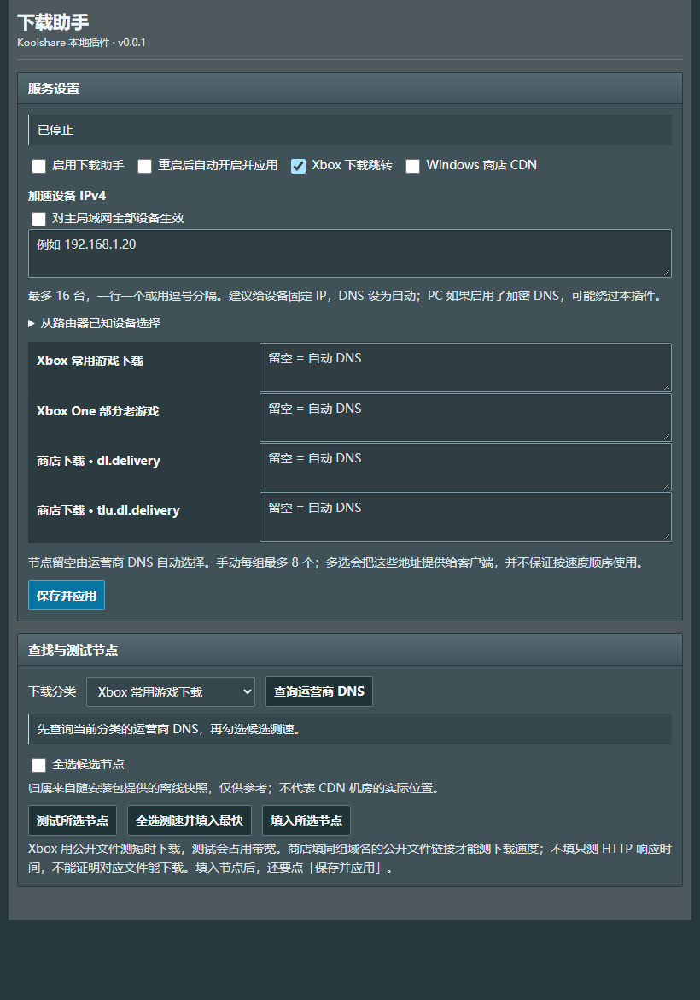

# 下载助手 · XBOXDL-Assist-KShare

下载助手是一个装在 Koolshare 软件中心里的路由器插件。它帮助家里的 Xbox 和 Windows 设备寻找合适的下载节点，让下载请求走你选择的线路。你可以先使用自动选择，也可以自己查询和测试节点。

*0.0.1 界面预览，显示默认示例状态。*

## 使用前准备

- 一台装有 Koolshare 软件中心的路由器，以及连在它主局域网里的 Xbox 或 Windows 电脑。
- 插件安装包：`xbfast-0.0.1.tar.gz`。安装时路由器需有至少 8 MiB 可用闪存。
- 路由器固件需要提供 `dbus`、`nvram`、`cru`、BusyBox、支持 `ipset` 的 `dnsmasq`、带 `mod_redirect` 的 Lighttpd、IPv4 `iptables` 的 `set` 匹配、`ipset`，以及支持 `--resolve` 的 `curl`。

**实机使用环境：**NETGEAR R6300V2，Koolshare 改版 `ASUSWRT-Merlin 380.70-0-X7.9.1`。用户反馈 `0.0.1` 安装正常并可以使用。

## 安装

1. 下载插件的 `.tar.gz` 安装包，保留压缩包格式。
2. 登录路由器管理页面，打开 **软件中心 → 离线安装**，选择安装包并开始安装。
3. 安装完成后，进入 **软件中心 → 已安装 → 下载助手**。首次安装时插件处于关闭状态。

安装程序要求先移除已有的下载助手版本。升级前请先记下设备和节点设置；如需保留旧版的本地归属库，也请先备份。然后通过软件中心卸载旧版，再安装新包并重新填写设置。`0.0.1` 的版本号低于此前候选版和部分旧版，请通过离线安装手动安装。

## 开始使用

1. 在 **加速设备 IPv4** 中填写要使用插件的设备地址，每行一个，最多 16 台。也可以展开 **从路由器已知设备选择**，刷新列表后勾选设备。列表读取路由器已有的设备记录。
2. 想让主局域网的所有设备使用时，勾选 **对主局域网全部设备生效**。原来填写的地址会保留；取消勾选后可以继续使用。独立访客网络和路由器本机有各自的网络范围。
3. 勾选 **启用下载助手**，再按需要勾选 **Xbox 下载跳转** 或 **Windows 商店 CDN**。节点地址先留空，交给运营商 DNS 自动选择。
4. 点击 **保存并应用**，然后在 Xbox 或电脑上开始下载。
5. 希望路由器重启后自动开启时，同时勾选 **启用下载助手** 和 **重启后自动开启并应用**，再点击 **保存并应用**。

建议在路由器的 DHCP 设置中为设备固定 IP 地址，让插件一直能找到它。设备 DNS 建议设为自动；插件处理经过主局域网的 IPv4 普通 DNS 请求，使用加密 DNS、IPv6 或其他网络路径时，请按设备网络设置调整。

下载线路按节点 IP 匹配。如果其他服务与下载节点共用同一个 IP，它们的连接也可能走直连线路。

## 查找更合适的节点

节点可以理解成下载内容的一个取货地点。自动选择用起来最简单；想比较线路时，可以在页面上测速。

1. 在 **查找与测试节点** 中选择下载分类，点击 **查询运营商 DNS**。
2. 勾选候选节点，点击 **测试所选节点**。Xbox 分类使用公开文件进行短时下载测速，会占用一些带宽。
3. 点击 **填入所选节点**，或使用 **全选测速并填入最快**。每组最多填写 8 个节点。
4. 点击 **保存并应用**，填写的节点才会生效。

Windows 商店分类需要填写该组域名下的公开下载文件链接才能比较下载速度；链接中请勿带查询参数。留空时页面显示 HTTP 响应时间。网络情况会变化，可以稍后重新查询和测试；多选节点时由设备决定使用顺序。

想回到自动选择时，清空相应分类的节点地址，再点击 **保存并应用**。

## IP 归属库

安装包内置预处理的 [ip2region](https://github.com/lionsoul2014/ip2region) 离线 IPv4 快照，首次安装无需另行下载或转换，也没有在线或自动更新。查询节点时，归属信息可供参考，与 CDN 机房的实际位置可能不同。来源说明和上游许可证在安装包的 `geo/` 文件夹。

## 遇到问题

| 现象 | 可以这样做 |
| --- | --- |
| 安装失败或提示已有插件 | 检查安装包是否完整、软件中心和固件组件是否满足要求，并留出至少 8 MiB 闪存；已有版本先记下设置、按需备份归属库并卸载，再安装。 |
| 列表里找不到设备 | 让设备先连接主局域网，刷新设备列表；也可以在设备网络设置中查看 IPv4 地址并手动填写。 |
| 下载速度没有改善 | 检查设备 IP、插件开关和下载分类，确认已点击 **保存并应用**；试试自动节点或重新查询、测速后选择节点。速度也会随线路和下载内容变化。 |
| 查不到候选节点 | 检查路由器的 WAN 网络和运营商 DNS 设置，稍后重新查询。切换下载分类后需要重新查询。 |
| 商店测速只有响应时间 | 在对应分类填写同组域名的公开下载文件链接，再重新测速。 |
| 节点显示「归属未知」 | 重新查询节点，或直接按测速结果选择。内置归属库为离线快照，部分地址可能没有记录。 |
| 页面显示应用失败或服务未启动 | 检查填写的 IP 和数量，稍后再点击 **保存并应用**。若问题持续，先关闭插件并保存，记录页面提示后寻求帮助。 |
| 关闭或卸载时提示清理失败 | 等待片刻后重试，保留页面提示和操作经过，方便排查。 |

要暂停使用，取消勾选 **启用下载助手** 并点击 **保存并应用**。要移除插件，在软件中心的已安装列表中选择下载助手并卸载。

反馈问题时，请附上路由器型号、固件和插件版本、操作步骤、页面提示，以及发生问题的大致时间；分享截图或日志前，请遮住公网 IP、设备名称和其他个人信息。

## 致谢与许可

感谢 [XboxDownload（Xbox 下载助手）](https://github.com/skydevil88/XboxDownload) 提供的国内 CDN 跳转思路，也感谢 [ip2region](https://github.com/lionsoul2014/ip2region) 提供 IP 归属数据。

本项目采用 [MIT 许可证](LICENSE)。安装包中的离线归属数据来自 ip2region 固定版本，上游采用 `Apache-2.0 OR MIT` 许可；来源说明和上游许可证位于安装包的 `geo/` 文件夹。
